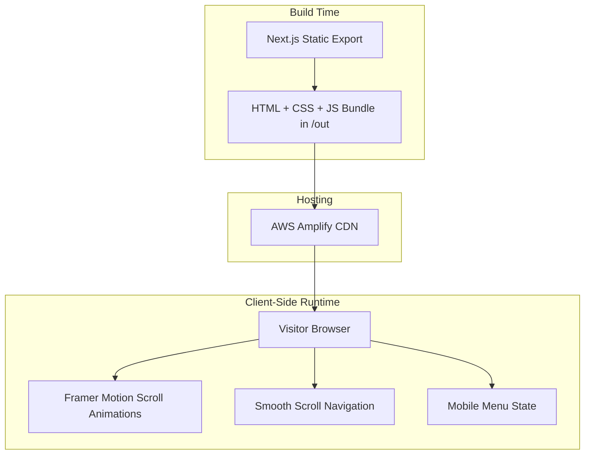
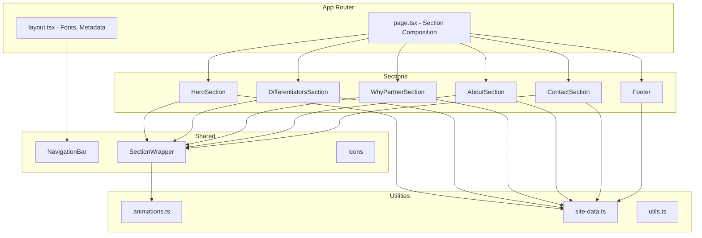

# Design Document: MartBridge Marketing Site

## Overview

The MartBridge Marketing Site is a single-page static marketing website built with Next.js 14 (App Router), TypeScript, Tailwind CSS, shadcn/ui, and Framer Motion. It serves as MartBridge's digital storefront, communicating brand identity and value propositions to prospective retailer and supplier partners in Andhra Pradesh, India.

The architecture prioritizes:
- **Static generation** for maximum performance and SEO
- **Component isolation** for maintainability
- **Motion system abstraction** for consistent animations with reduced-motion support
- **Responsive-first design** using Tailwind's utility system
- **Accessibility compliance** (WCAG 2.1 AA) baked into component design

The site deploys as a fully static export to AWS Amplify, requiring zero server-side infrastructure.

**Key Design Decisions:**
- Single `page.tsx` with section components — avoids routing complexity for a one-page site
- Static data objects co-located in `lib/site-data.ts` — single source of truth, no API calls
- Framer Motion `useInView` for scroll-triggered animations with `prefers-reduced-motion` respect
- Mobile-first responsive approach using Tailwind breakpoints
- shadcn/ui for accessible, unstyled primitives (Sheet for mobile nav, Button for CTAs)

## Architecture

### High-Level Architecture



### Application Architecture



### Rendering Strategy

- **Static Generation (SSG)**: The entire site is pre-rendered at build time via `output: 'export'`. No `getServerSideProps`, no API routes, no dynamic rendering.
- **Client-side interactivity**: Framer Motion animations and smooth-scroll navigation run client-side. Components using these are marked `"use client"`.
- **Build output**: A fully static `/out` directory served by AWS Amplify's built-in CDN with automatic HTTPS.

### Design Decisions

| Decision | Choice | Rationale |
|----------|--------|-----------|
| State management | React `useState` only | Minimal state (mobile menu open/close, scroll position). No global state library needed. |
| Animation approach | Framer Motion `useInView` + variants | Declarative, performant scroll-triggered animations with built-in reduced-motion API. |
| CSS strategy | Tailwind CSS + shadcn/ui primitives | Utility-first for rapid iteration; shadcn gives accessible, unstyled component primitives. |
| Font loading | `next/font/google` with Inter | Optimized font loading with zero layout shift; Inter is a premium sans-serif suited to B2B. |
| Image handling | `next/image` with `unoptimized: true` | Lazy loading and proper sizing. Static export requires `unoptimized`; images are pre-optimized manually. |
| Scroll behavior | `scrollIntoView({ behavior: 'smooth' })` | Native smooth scrolling, no extra JS library. Degrades to instant scroll if unsupported. |
| Static export | `output: 'export'` in next.config | Required for AWS Amplify static hosting; no server-side features used. |

## Components and Interfaces

### Visual Composition by Section

This section defines the concrete visual layout — not just the components, but how imagery, spacing, background, and content blocks are composed within each section.

---

#### Hero Section — Visual Composition

**Layout Pattern:** Full-viewport, center-weighted text composition over a deep navy (#0B1F3F) background.

- **Background:** Solid navy fill with a subtle radial gradient (navy center fading to slightly darker navy at edges) to add depth without imagery.
- **Content placement:** Centered horizontally and vertically within the viewport. Stack order: Logo → Tagline → Subheading → CTA button.
- **Logo treatment:** The MartBridge "M" mark (navy letter with orange bridge motif) rendered as an inline SVG at 72px height, centered above the tagline.
- **Typography:** Tagline ("Connecting Stores to Supply") in white, 48px/3rem on desktop, bold weight. Subheading in white/80 opacity, 18px, max-width 540px, centered.
- **CTA Button:** Solid orange (#F47920) fill with white text, 16px, rounded-lg, generous horizontal padding (px-8 py-3). Hover: scale(1.02) + slight brightness increase.
- **Graphic accents:** Two abstract geometric shapes (soft orange-tinted, low-opacity blurred circles) positioned off-center in the background — one top-right, one bottom-left — to break visual flatness without competing with text.
- **Whitespace:** Minimum 80px padding top/bottom on desktop. CTA sits 32px below the subheading.
- **Responsive (mobile):** Logo scales to 56px. Tagline drops to 32px/2rem. Geometric accents hidden below 768px to avoid clutter.

---

#### Differentiators Section — Visual Composition (Icon-Card Grid)

**Layout Pattern:** 4-column icon-card grid on a white background, positioned immediately below the Hero to deliver value propositions before the visitor scrolls further.

- **Background:** White (#FFFFFF) with generous vertical padding (80px top, 80px bottom on desktop).
- **Section heading:** "What Sets Us Apart" — centered, navy text, 32px/2rem, semibold. Sits 0px from top padding (flush with section start).
- **Card layout (desktop ≥1024px):** 4 equal-width cards in a single row using CSS Grid (`grid-cols-4`, gap-6).
- **Card layout (tablet 768px–1023px):** 2×2 grid (`grid-cols-2`, gap-6).
- **Card layout (mobile <768px):** Single column stack, full-width cards, gap-4.
- **Individual card composition:** Each card is a rounded-xl container (white fill, soft shadow `shadow-sm`, subtle 1px border in gray-100) with internal padding (p-6). Stack: Icon (top-center, 40px, orange color) → Title (navy, 16px, semibold, mt-4) → Description (gray-600, 14px, mt-2, max 2 lines).
- **Icon treatment:** Lucide React icons rendered at 40px in primary orange (#F47920). Each differentiator uses a distinct icon: PackageSearch, Truck, ShieldCheck, TrendingDown.
- **Animation:** Cards enter with staggered fade-up (200ms delay between each), triggered by `useInView`.
- **Whitespace:** 24px gap between cards. 16px between heading and first row of cards.

---

#### Why Partner With Us Section — Visual Composition (Alternating Horizontal Layout)

**Layout Pattern:** Alternating left-right horizontal blocks — each trust signal occupies a full-width row with a large stat/callout on one side and supporting descriptive text on the other. This is intentionally distinct from the Differentiators grid above.

- **Background:** Light gray (#F9FAFB) to visually separate this section from the About section above it and provide contrast with the white Differentiators section. Vertical padding: 96px top, 96px bottom on desktop.
- **Section heading:** "Why Partner With Us" — left-aligned within the content container, navy text, 32px/2rem, semibold. A small orange accent bar (4px wide, 32px tall) sits to the left of the heading.
- **Row layout (desktop ≥1024px):** Each trust signal is a full-width row split into two halves:
  - **Odd rows (1st, 3rd):** Left half = large icon (64px, orange) with bold stat-style title (24px navy, semibold), Right half = descriptive paragraph (16px gray-600, max-width 480px) with the description text.
  - **Even rows (2nd, 4th):** Reversed — description on left, icon + title on right.
  - Items are vertically centered within each row. Rows are separated by 48px vertical gap.
- **Row layout (tablet 768px–1023px):** Same alternating pattern but with 60/40 split instead of 50/50.
- **Row layout (mobile <768px):** Stacks vertically — icon + title on top, description below. All rows left-aligned. 32px gap between rows.
- **Stat-style callout treatment:** The title for each trust signal renders large (24px) as though it were a metric or highlight, making it visually distinct from the small card-title treatment in Differentiators.
- **Icon treatment:** Lucide React icons at 64px (vs 40px in Differentiators) in orange with a soft orange-tinted circular background (bg-orange-50, rounded-full, p-4).
- **Animation:** Each row slides in from its content side (odd rows slide from left, even rows from right), triggered by `useInView`.
- **Visual distinction from Differentiators:** This section uses (a) alternating layout vs. grid, (b) larger icons with backgrounds, (c) stat-style typography, (d) gray background, (e) row-based rhythm vs. card-based rhythm.

---

#### About Section — Visual Composition (Asymmetric Two-Column)

**Layout Pattern:** **Asymmetric 60/40 split** — left column (60%) holds textual content, right column (40%) holds a graphic/imagery element. This section fulfills Requirement 9.5's mandate for asymmetric, contemporary layout.

- **Background:** White (#FFFFFF). Vertical padding: 96px top, 96px bottom.
- **Left column (60% width on desktop):**
  - Section heading "About MartBridge" — navy, 32px/2rem, semibold.
  - Mission statement paragraph — gray-700, 18px/1.75 line-height, max-width 560px.
  - Retailer-benefit narrative — gray-600, 16px, mt-6. Communicates quality products, competitive prices, dependable delivery.
  - Founder attribution — mt-8. Founder name "Palani Kumar" in navy bold 16px, title "Founder & CEO" in gray-500 14px, displayed as a block quote-style element with a left orange border (4px).
- **Right column (40% width on desktop):**
  - **Imagery:** An abstract illustration representing supply-chain connectivity — a stylized network/bridge graphic using the brand's navy and orange palette. This is a custom SVG illustration (not photography).
  - **Image source:** To be created as a vector SVG asset. For initial build, use a geometric abstract placeholder (overlapping circles and lines in navy/orange) that communicates "connection" and "network." Final production asset can be commissioned illustration or refined vector graphic — no photography required.
  - **Fallback:** If illustration is unavailable at build time, render an abstract CSS-only composition (overlapping rounded shapes using Tailwind's absolute positioning, bg-navy/bg-orange with opacity layering) as a decorative element.
- **Asymmetric behavior (tablet 768px–1023px):** 55/45 split. Illustration scales down proportionally.
- **Mobile (<768px):** Stacks vertically — text content first (full width), illustration below at 240px max height, centered.
- **Animation:** Left column fades up; right column fades in with slight scale from 0.95.

---

#### Contact Section — Visual Composition

**Layout Pattern:** Centered content block on navy background, creating a strong visual anchor before the Footer.

- **Background:** Primary navy (#0B1F3F), matching the Hero for bookend symmetry. Vertical padding: 80px top, 80px bottom.
- **Section heading:** "Get In Touch" — white text, centered, 32px/2rem, semibold.
- **Content layout (desktop):** A centered container (max-width 720px) with contact items arranged in a 2×2 grid:
  - Top-left: Phone (with tel: link)
  - Top-right: Email (with mailto: link)
  - Bottom-left: WhatsApp (with wa.me deep link)
  - Bottom-right: Location (plain text, no link)
- **Contact item composition:** Each item is an inline-flex row: Icon (20px, orange) + Label text (white, 16px) with hover underline effect on linked items.
- **Social links row:** Below the 2×2 grid, centered row of 3 social icons (Facebook, Instagram, WhatsApp) at 32px, white fill, with hover transition to orange. 24px gap between icons.
- **CTA hint:** Below social icons, a subtle line of text in white/60 opacity: "We'd love to hear from you" — adding warmth.
- **Mobile (<768px):** Contact items stack in a single column, left-aligned, full-width. Social icons remain centered.
- **Animation:** Section fades in as a whole block; individual contact items stagger slightly (100ms each).

---

### Imagery Strategy

**Overall approach:** The site uses **abstract vector illustrations and geometric graphic elements** rather than photography. This choice is driven by:
1. No photography assets are available or budgeted for Phase 1
2. Abstract graphics scale perfectly across all viewport sizes
3. SVG illustrations maintain quality on high-DPI displays without size cost
4. The brand's geometric bridge motif translates naturally to abstract vector art

**Asset sources and delivery plan:**

| Asset | Type | Source | Delivery |
|-------|------|--------|----------|
| Hero background accents | CSS/SVG shapes | Generated in code (Tailwind absolute positioning + blur) | Built into component |
| Differentiators icons | Lucide React icons (SVG) | Open-source library (`lucide-react`) | npm dependency |
| Why Partner icons | Lucide React icons (SVG) | Open-source library (`lucide-react`) | npm dependency |
| About section illustration | Custom SVG vector graphic | Phase 1: Geometric placeholder built in code. Phase 2: Commissioned vector illustration. | `/public/images/network-illustration.svg` |
| MartBridge logo | Inline SVG component | Provided brand asset | `components/icons/martbridge-logo.tsx` |
| OG share image | Static PNG (1200×630) | To be designed in Figma/Canva using brand colors | `/public/og-image.png` |

**Photography policy:** No stock photography is used. If photography is added in a future phase, it should be custom or locally-sourced imagery of AP retail stores/markets — not generic stock.

---

### File Structure

```
src/
├── app/
│   ├── layout.tsx              # Root layout: fonts, metadata, NavigationBar
│   ├── page.tsx                # Home page: composes all sections sequentially
│   ├── globals.css             # Tailwind directives, CSS custom properties
│   └── favicon.ico
├── components/
│   ├── ui/                     # shadcn/ui primitives
│   │   ├── button.tsx
│   │   └── sheet.tsx           # Used for mobile nav overlay
│   ├── navigation-bar.tsx      # Fixed top nav with mobile hamburger
│   ├── hero-section.tsx        # Logo, tagline, CTA
│   ├── differentiators-section.tsx  # 4 icon-card grid
│   ├── why-partner-section.tsx      # 4 alternating horizontal rows
│   ├── about-section.tsx       # Asymmetric 60/40: text + illustration
│   ├── contact-section.tsx     # Contact info + social links on navy
│   ├── footer.tsx              # Footer nav, social icons, copyright
│   ├── section-wrapper.tsx     # Reusable scroll-animation container
│   └── icons/
│       ├── martbridge-logo.tsx # SVG logo component
│       └── social-icons.tsx    # Facebook, Instagram, WhatsApp icons
├── lib/
│   ├── site-data.ts            # All static content constants
│   ├── animations.ts           # Framer Motion variant definitions
│   └── utils.ts                # cn() helper (shadcn/ui pattern)
└── public/
    ├── og-image.png            # Open Graph social sharing image (1200×630)
    ├── favicon.ico
    └── images/                 # SVG illustrations and vector assets
        └── network-illustration.svg  # About section graphic (placeholder → final)
```

### Component Interfaces

```typescript
// lib/site-data.ts — Core data types
export interface DifferentiatorCard {
  icon: React.ReactNode;
  title: string;
  description: string;
}

export interface TrustSignal {
  icon: React.ReactNode;
  title: string;       // Rendered as stat-style callout (large, bold)
  description: string; // Rendered as supporting paragraph
}

export interface NavLink {
  label: string;
  href: string;   // Anchor link, e.g., "#contact"
}

export interface ContactLink {
  type: "phone" | "email" | "website" | "whatsapp" | "facebook" | "instagram";
  label: string;
  href: string;
  ariaLabel: string;
}

export interface SocialLink {
  platform: "facebook" | "whatsapp" | "instagram";
  href: string;
  icon: React.ReactNode;
  ariaLabel: string;
}
```

```typescript
// components/section-wrapper.tsx
interface SectionWrapperProps {
  id?: string;                                    // Anchor ID for navigation
  children: React.ReactNode;
  className?: string;
  animation?: "fade-up" | "fade-in" | "scale" | "slide-left" | "slide-right";
}
```

```typescript
// components/navigation-bar.tsx (internal state)
// Props: none (reads navLinks from site-data.ts)
// State: isMobileMenuOpen (boolean), isScrolled (boolean)
```

### Key Component Behaviors

| Component | Client/Server | Key Behavior |
|-----------|--------------|--------------|
| `layout.tsx` | Server | Loads Inter font via `next/font`, sets metadata, wraps page in NavigationBar |
| `page.tsx` | Server | Composes all section components sequentially |
| `NavigationBar` | Client | Fixed positioning, background appears on scroll, mobile Sheet toggle, smooth scroll on link click |
| `HeroSection` | Client | Entry animation (fade-up), CTA button scrolls to Contact. Navy BG with radial gradient + geometric accents |
| `DifferentiatorsSection` | Client | 4 icon-cards in responsive grid (4-col → 2-col → 1-col). Staggered fade-up entrance |
| `WhyPartnerSection` | Client | 4 alternating horizontal rows with large stat-style titles. Slide-in from alternating sides |
| `AboutSection` | Client | Asymmetric 60/40 layout: text left, SVG illustration right. Scroll-triggered fade-in |
| `ContactSection` | Client | Navy BG, 2×2 contact grid, social icons row. Contact links (tel:, mailto:, wa.me) |
| `Footer` | Server | Static nav links, social icons, copyright with dynamic year |
| `SectionWrapper` | Client | Framer Motion `useInView` + `motion.div` with selected variant |

## Data Models

This is a static site with no database, API, or dynamic data. All content is defined as TypeScript constants in `lib/site-data.ts`.

### Site Configuration

```typescript
// lib/site-data.ts
export const siteConfig = {
  name: "MartBridge",
  tagline: "Connecting Stores to Supply",
  description: "B2B retail supply platform connecting local retail stores in Andhra Pradesh to a trusted supplier network",
  url: "https://www.martbridge.com",
  founder: { name: "Palani Kumar", title: "Founder & CEO" },
  contact: {
    phone: "9347142434",
    email: "palani@martbrige.com", // TBD: confirm spelling before launch
    location: "Andhra Pradesh, India",
  },
  social: {
    facebook: "https://facebook.com/martbridge.in",
    instagram: "https://instagram.com/martbridge.in",
    whatsapp: "https://wa.me/9347142434",
  },
} as const;
```

### Section Content

```typescript
export const differentiators: DifferentiatorCard[] = [
  { icon: /* PackageSearch */, title: "Wide range of products", description: "..." },
  { icon: /* Truck */,         title: "Fast & reliable delivery", description: "..." },
  { icon: /* ShieldCheck */,   title: "Trust & transparency", description: "..." },
  { icon: /* TrendingDown */,  title: "Better prices everyday", description: "..." },
];

export const trustSignals: TrustSignal[] = [
  { icon: /* Warehouse */,   title: "Large stock availability", description: "..." },
  { icon: /* BadgeCheck */,  title: "Quality assured", description: "..." },
  { icon: /* Handshake */,   title: "Built on trust", description: "..." },
  { icon: /* Sprout */,      title: "Growing together", description: "..." },
];

export const navLinks: NavLink[] = [
  { label: "Home", href: "#hero" },
  { label: "Differentiators", href: "#differentiators" },
  { label: "About", href: "#about" },
  { label: "Contact", href: "#contact" },
];
```

### Metadata (Next.js)

```typescript
// app/layout.tsx
export const metadata: Metadata = {
  title: "MartBridge — Connecting Stores to Supply | B2B Retail Platform",
  description: "MartBridge connects local retail stores in Andhra Pradesh to a trusted supplier and distribution network. Quality products, competitive prices, dependable delivery.",
  openGraph: {
    title: "MartBridge — Connecting Stores to Supply",
    description: "B2B retail supply platform for local retail stores in Andhra Pradesh, India.",
    url: "https://www.martbridge.com",
    siteName: "MartBridge",
    type: "website",
    images: [{ url: "/og-image.png", width: 1200, height: 630 }],
  },
};
```

### State Model

| State | Location | Type | Purpose |
|-------|----------|------|---------|
| `isMobileMenuOpen` | NavigationBar | `boolean` | Toggle mobile nav Sheet overlay |
| `isScrolled` | NavigationBar | `boolean` | Apply solid background after scroll threshold |

No external state management, no context providers, no reducers.

## Correctness Properties

*A property is a characteristic or behavior that should hold true across all valid executions of a system — essentially, a formal statement about what the system should do. Properties serve as the bridge between human-readable specifications and machine-verifiable correctness guarantees.*

This feature is a static marketing landing page — property-based testing does not apply. It consists of UI rendering (React components displaying hardcoded content), CSS-driven responsive layouts, declarative animations, and static configuration. There are no pure functions with meaningful input variation, no data transformations, no parsers or serializers, and no business logic algorithms. Correctness is validated through component unit tests, accessibility audits (jest-axe), visual regression tests, and Lighthouse CI score thresholds.

### Property 1: Static content integrity

*For any* build of the Marketing Site, all hardcoded content strings defined in `site-data.ts` (differentiator titles, trust signal titles, contact information, founder name) SHALL appear in the rendered HTML output unchanged.

**Validates: Requirements 1.1, 3.1, 4.1, 5.1, 5.2, 5.3, 6.1**

## Error Handling

### Build-Time Errors

| Error Type | Handling |
|------------|----------|
| TypeScript compilation errors | Next.js build fails with file/line reference in build log |
| Missing image imports | Build-time error from Next.js static analysis |
| Invalid Tailwind classes | Flagged by IDE tooling; no runtime error |
| ESLint violations | `next lint` runs in CI; blocks build if configured strict |

### Runtime Considerations

Since this is a static marketing site with no API calls, backend, or user input, runtime errors are minimal:

| Scenario | Handling |
|----------|----------|
| JavaScript disabled | All content renders as static HTML. Animations don't play but content is fully visible and readable. |
| Missing images | `alt` text displays via standard browser fallback. |
| Broken external links (social) | Links open in new tab; browser handles unreachable targets. No in-app error state needed. |
| Smooth scroll unsupported | Anchor links with `href="#section-id"` still navigate to the correct section (instant jump). |
| Font loading failure | `next/font` uses `display: 'swap'` — system font shows immediately, web font swaps in when loaded. |
| Framer Motion hydration failure | Content renders statically without animations. `useInView` defaults to elements being visible. |

### Reduced Motion Graceful Degradation

When `prefers-reduced-motion: reduce` is active:
- All Framer Motion animations are disabled (using `useReducedMotion()` hook)
- CSS transitions are suppressed via `motion-reduce:transition-none`
- Content is immediately visible in final position — no opacity 0 states

## Testing Strategy

### Why Property-Based Testing Does Not Apply

This feature is a static marketing landing page consisting of:
- **UI rendering** — React components displaying hardcoded content
- **CSS-driven responsive layouts** — breakpoint behavior via Tailwind utilities
- **Declarative animations** — Framer Motion configuration objects
- **Static configuration** — metadata, constants, deployment config

There are no pure functions with meaningful input variation, no data transformations, no parsers or serializers, and no business logic algorithms. PBT requires a "for all inputs X, property P(X) holds" statement — but the inputs here are fixed content and viewport dimensions, not a combinatorial space that benefits from random generation.

### Testing Approach

**1. Component Unit Tests (Vitest + React Testing Library)**

| Test | What It Verifies |
|------|------------------|
| Hero section content | Logo, tagline, CTA button render correctly |
| Differentiators content | All 4 cards with correct titles render in grid layout |
| Why Partner content | All 4 trust signals render in alternating row layout |
| About section content | Mission text, founder name/title, illustration placeholder render |
| Contact section links | Correct `href` values: `tel:`, `mailto:`, `https://wa.me/` |
| Footer content | Copyright year, nav links, social icons render |
| Navigation links | All section links present with correct anchors |
| Mobile menu toggle | Menu opens on hamburger click, closes on link click or Escape |
| External link attributes | Social links have `target="_blank"` and `rel="noopener noreferrer"` |

**2. Accessibility Tests (jest-axe)**

- Automated axe-core audit on each section component (catches ~57% of WCAG issues)
- Verify all `` elements have non-empty `alt` attributes
- Verify icon-only buttons have `aria-label`
- Verify heading hierarchy (h1 → h2 → h3, no skips)
- Verify focus management in mobile menu (trap focus, return focus on close)
- Verify keyboard navigation: Tab through interactive elements, Enter activates, Escape closes menu

**3. Visual Regression (Playwright)**

- Screenshot comparison at 320px, 768px, 1024px, 1280px, 1920px viewports
- Detect unintended layout shifts from CSS changes
- Verify responsive breakpoint behavior
- Verify asymmetric About section layout at desktop widths
- Verify Differentiators grid vs Why Partner alternating rows are visually distinct

**4. Lighthouse CI (Performance Gate)**

- Desktop: Performance ≥ 90, Accessibility ≥ 90, SEO ≥ 90
- Mobile: Performance ≥ 80, Accessibility ≥ 90, SEO ≥ 90
- Run in CI pipeline on every PR

**5. Build Verification**

- `next build` completes without errors
- `/out` directory is produced with `index.html`
- All static assets referenced in HTML exist in output

### Animation Strategy

**Library:** Framer Motion 11+ with `useInView` hook for scroll-triggered entrance animations.

**Animation variants** (defined in `lib/animations.ts`):

| Variant | Initial State | Animate State | Use Case |
|---------|--------------|---------------|----------|
| `fade-up` | opacity: 0, y: 24 | opacity: 1, y: 0 | Hero content, Differentiator cards |
| `fade-in` | opacity: 0 | opacity: 1 | About text, Contact section |
| `scale` | opacity: 0, scale: 0.95 | opacity: 1, scale: 1 | About illustration |
| `slide-left` | opacity: 0, x: -40 | opacity: 1, x: 0 | Why Partner odd rows |
| `slide-right` | opacity: 0, x: 40 | opacity: 1, x: 0 | Why Partner even rows |

**Configuration:**
- Duration: 500ms (entrance), 150–300ms (hover transitions)
- Easing: `[0.25, 0.1, 0.25, 1]` (CSS ease equivalent)
- Stagger: 200ms between sibling items (Differentiators cards)
- Trigger: `useInView` with `{ once: true, margin: "-100px" }` — animates once when element is 100px into viewport
- Reduced motion: `useReducedMotion()` hook disables all motion variants; elements render in final state immediately

### Responsive Design Strategy

**Breakpoint system** (Tailwind defaults):

| Breakpoint | Width | Layout Behavior |
|------------|-------|-----------------|
| Default (mobile) | <768px | Single column, stacked sections, hamburger menu |
| `md` | ≥768px | Multi-column begins, nav links visible, tablet grids |
| `lg` | ≥1024px | Full desktop layout, 4-col Differentiators grid, 60/40 About split |
| `xl` | ≥1280px | Max-width container (1280px), centered with auto margins |
| `2xl` | ≥1536px | Same as xl — content doesn't stretch beyond 1280px container |

**Section-specific responsive behavior:**

| Section | Mobile (<768px) | Tablet (768–1023px) | Desktop (≥1024px) |
|---------|-----------------|---------------------|---------------------|
| Hero | Centered, smaller text, no BG accents | Centered, full text sizes, BG accents visible | Full composition with geometric accents |
| Differentiators | 1 column stack | 2×2 grid | 4-column grid |
| Why Partner | Stacked (icon+title above description) | Alternating 60/40 rows | Alternating 50/50 rows |
| About | Stacked (text above illustration) | 55/45 split | 60/40 asymmetric split |
| Contact | Single column, left-aligned items | 2×2 grid, centered | 2×2 grid, centered |

### Deployment Configuration

- **Platform:** AWS Amplify (static hosting)
- **Build spec:** `amplify.yml` at project root
- **Build command:** `npm run build` → triggers `next build`
- **Output directory:** `out/` (from `output: 'export'` in `next.config.ts`)
- **Node version:** 18.x (specified in amplify.yml)
- **Environment variables:** None required (fully static, no secrets)
- **Custom headers:** Cache-control for static assets (1 year for hashed JS/CSS, no-cache for HTML)

```yaml
# amplify.yml
version: 1
frontend:
  phases:
    preBuild:
      commands:
        - npm ci
    build:
      commands:
        - npm run build
  artifacts:
    baseDirectory: out
    files:
      - '**/*'
  cache:
    paths:
      - node_modules/**/*
      - .next/cache/**/*
```

### Test File Structure

```
__tests__/
├── components/
│   ├── navigation-bar.test.tsx
│   ├── hero-section.test.tsx
│   ├── differentiators-section.test.tsx
│   ├── why-partner-section.test.tsx
│   ├── about-section.test.tsx
│   ├── contact-section.test.tsx
│   └── footer.test.tsx
├── accessibility/
│   └── axe-audit.test.tsx
└── build/
    └── static-export.test.ts
```

### Test Tooling

| Tool | Purpose |
|------|---------|
| Vitest | Test runner — fast, ESM-native, integrates with Next.js |
| React Testing Library | DOM rendering and user interaction simulation |
| jest-axe | Accessibility assertions (WCAG rule validation) |
| Lighthouse CI | Performance, accessibility, SEO scoring in CI |
| Playwright | E2E tests, visual regression screenshots, responsive layout verification |
