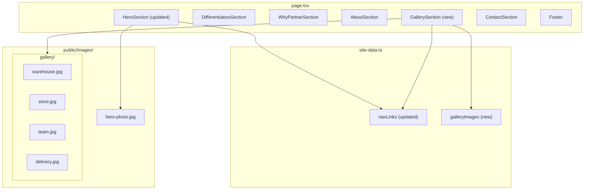

# Design Document: Photo Gallery Integration

## Overview

This design introduces real photography into the MartBridge marketing site through two coordinated changes:

1. **Hero Section redesign** — Convert the existing centered text layout to an asymmetric two-column layout (text left, photo right) with a CSS clip-path mask on the photo.
2. **Gallery Section** — A new section placed between the About and Contact sections showing a 2×2 photo grid of MartBridge operations with hover-zoom effects and staggered scroll-triggered animations.

Both additions re-use existing patterns (Framer Motion animations, `SectionWrapper`, Tailwind utility classes, `next/image` with unoptimized mode) and introduce no new runtime dependencies. Static images are served from `public/images/` and survive the `next build` static export unchanged.

### Key Design Decisions

| Decision | Rationale |
|----------|-----------|
| Re-use `framer-motion` animation system | Consistency with existing sections; avoids new dependency |
| CSS `clip-path: polygon()` for hero photo mask | Hardware-accelerated, no image manipulation needed, works with static export |
| `next/image` with `fill` + `unoptimized` | Matches existing image strategy; required for `output: "export"` |
| Gallery images in a `<ul>/<li>` structure | WCAG 2.1 AA — assistive technology can announce count and position |
| Tailwind `overflow-hidden` + `scale` for hover-zoom | Contained within cell, no layout shift, CSS-only performance |
| Gallery nav link added to `site-data.ts` | Single source of truth for navigation; no code duplication |

---

## Architecture



### Section Ordering in `page.tsx`

```
HeroSection → DifferentiatorsSection → WhyPartnerSection → AboutSection → GallerySection → ContactSection → Footer
```

### File Changes Summary

| File | Action |
|------|--------|
| `src/app/page.tsx` | Add `GallerySection` import and render between About and Contact |
| `src/components/hero-section.tsx` | Rewrite to asymmetric two-column layout with `next/image` |
| `src/components/gallery-section.tsx` | New file — 2×2 photo grid section |
| `src/lib/site-data.ts` | Add `galleryImages` data array; insert "Gallery" into `navLinks` |
| `public/images/hero-photo.jpg` | New asset (placeholder or real photo) |
| `public/images/gallery/*.jpg` | Four new gallery photo assets |

---

## Components and Interfaces

### Updated: `HeroSection`

**Location:** `src/components/hero-section.tsx`

**Props:** None (self-contained, reads from `siteConfig`)

**Behavior:**
- Desktop (≥768px): Two-column grid `md:grid-cols-[60fr_40fr]`
  - Left column: logo, h1 tagline, description paragraph, CTA button — all left-aligned
  - Right column: `next/image` with `fill`, `priority`, `object-fit: cover`, and a `clip-path: polygon(...)` mask
- Mobile (<768px): Single column — text stacked above photo (max-height 240px)
- Animations: fade-up on text column, fade-in on photo column (500ms, ease `[0.25, 0.1, 0.25, 1]`)
- Reduced motion: immediate visible state, no transitions
- Error fallback: `onError` handler shows alt text in the image container area

**Key CSS:**
```css
.hero-photo-mask {
  clip-path: polygon(15% 0%, 100% 0%, 100% 100%, 0% 100%);
}
```
The left edge deviates ~15% from a straight vertical line (well exceeding the 20px minimum).

### New: `GallerySection`

**Location:** `src/components/gallery-section.tsx`

**Props:** None (reads from `galleryImages` in `site-data.ts`)

**Structure:**
```tsx
<section id="gallery" className="bg-white py-24">
  <div className="mx-auto max-w-7xl px-4 sm:px-6 lg:px-8">
    <h2>Our Operations</h2>
    <motion.ul className="grid grid-cols-1 md:grid-cols-2 gap-5">
      {galleryImages.map((img, i) => (
        <motion.li key={img.src} /* stagger delay */>
          <div className="relative overflow-hidden rounded-xl aspect-[3/2]">
            <Image
              src={img.src}
              alt={img.alt}
              fill
              unoptimized
              className="object-cover transition-transform duration-300
                         hover:scale-[1.05]
                         motion-reduce:transition-none motion-reduce:hover:scale-100"
            />
          </div>
        </motion.li>
      ))}
    </motion.ul>
  </div>
</section>
```

**Behavior:**
- Desktop (≥768px): `grid-cols-2` → 2×2 layout
- Mobile (<768px): `grid-cols-1` → single stacked column
- Hover: `scale(1.05)` with 300ms transition, contained by `overflow-hidden`
- Scroll animation: Framer Motion `useInView` with `margin: "-100px"`, `once: true`; stagger 200ms between children
- Reduced motion: no entrance animation, no hover scale
- Image error: `onError` handler displays alt text as visible fallback

### Updated: `site-data.ts`

New exports:

```typescript
export interface GalleryImage {
  src: string;
  alt: string;
}

export const galleryImages: GalleryImage[] = [
  {
    src: "/images/gallery/warehouse.jpg",
    alt: "MartBridge warehouse stocked with wholesale products ready for distribution",
  },
  {
    src: "/images/gallery/store.jpg",
    alt: "Retail partner store shelves filled with products supplied by MartBridge",
  },
  {
    src: "/images/gallery/team.jpg",
    alt: "MartBridge founding team collaborating in the operations office",
  },
  {
    src: "/images/gallery/delivery.jpg",
    alt: "MartBridge delivery vehicle loaded for a retail partner shipment",
  },
];
```

Updated `navLinks` — insert Gallery between About and Contact:

```typescript
export const navLinks: NavLink[] = [
  { label: "Home", href: "#hero" },
  { label: "Differentiators", href: "#differentiators" },
  { label: "About", href: "#about" },
  { label: "Gallery", href: "#gallery" },  // new
  { label: "Contact", href: "#contact" },
];
```

---

## Data Models

### `GalleryImage`

| Field | Type | Constraints |
|-------|------|-------------|
| `src` | `string` | Absolute path from public root, must end with `.jpg` |
| `alt` | `string` | 10–125 characters, describes the specific photo subject |

### `NavLink` (existing, unchanged)

| Field | Type | Constraints |
|-------|------|-------------|
| `label` | `string` | Display text for the navigation item |
| `href` | `string` | Anchor link starting with `#` |

### Static Asset Inventory

```
public/
└── images/
    ├── hero-photo.jpg        (≥10 KB, JPEG)
    └── gallery/
        ├── warehouse.jpg     (≥10 KB, JPEG)
        ├── store.jpg         (≥10 KB, JPEG)
        ├── team.jpg          (≥10 KB, JPEG)
        └── delivery.jpg      (≥10 KB, JPEG)
```

No database, API, or external data sources. All data is static and co-located.

---

## Error Handling

### Image Load Failures

Both `HeroSection` and `GallerySection` must gracefully handle broken image paths or network failures:

**Strategy:** Attach an `onError` handler to each `next/image` component that sets local state, conditionally rendering alt text as a visible `<span>` fallback within the image container.

```tsx
const [imageError, setImageError] = useState(false);

// In render:
{imageError ? (
  <span className="flex items-center justify-center h-full text-sm text-gray-600 bg-gray-100 p-4">
    {altText}
  </span>
) : (
  <Image
    src={src}
    alt={altText}
    fill
    unoptimized
    onError={() => setImageError(true)}
    className="object-cover"
  />
)}
```

**Hero Photo:** The two-column layout is maintained regardless of image load state — the right column shows alt text within the same grid cell.

**Gallery Images:** Each `<li>` maintains its aspect ratio container even on error, showing the alt text centered within the cell.

### Missing Asset Files

If photo files are missing from `public/images/`, the static build (`next build`) will still succeed (Next.js doesn't validate static assets at build time). The runtime behavior falls back to the `onError` handlers above. A smoke test in CI should verify file existence.

### Reduced Motion

When `prefers-reduced-motion: reduce` is active:
- Hero: Both columns render in final visible state immediately (no opacity/transform transition)
- Gallery: All images render at full opacity immediately; hover-zoom scale is disabled via `motion-reduce:` Tailwind utilities

This is not technically an "error" but an accessibility preference that alters rendering behavior significantly, so it's documented here.

---

## Testing Strategy

### Why Property-Based Testing Does Not Apply

This feature is primarily UI rendering, CSS layout, and static asset management:
- All inputs are fixed and known (4 specific images, specific breakpoints, specific CSS values)
- There are no pure functions with varying inputs that produce universal properties
- Behavior is visual/structural rather than data-transformational
- There is no serialization, parsing, algorithm, or business logic layer

Property-based testing is not appropriate here. The testing strategy uses **example-based unit tests** for component behavior and **integration/smoke tests** for build output and visual correctness.

### Unit Tests (Vitest + React Testing Library)

Location: `src/__tests__/components/`

**HeroSection tests (`hero-section.test.tsx`):**
- Renders two-column grid layout with correct structure
- Renders `next/image` with src="/images/hero-photo.jpg", priority, fill, unoptimized
- Alt text is at least 10 characters and descriptive (not generic)
- Clip-path style is applied to the image container
- Reduced motion: no animation variants applied (mock `useReducedMotion`)
- Image error fallback: displays alt text visibly when `onError` fires
- Mobile rendering: photo appears below text (single column structure)

**GallerySection tests (`gallery-section.test.tsx`):**
- Renders a `<section>` with `id="gallery"` and an `<h2>` heading
- Contains a `<ul>` with exactly 4 `<li>` elements
- Each `<li>` contains a `next/image` with correct src, alt (10-125 chars), fill, unoptimized
- No `priority` prop on gallery images
- `overflow-hidden` class on image containers
- Hover scale class (`hover:scale-[1.05]`) present on images
- Reduced motion: `motion-reduce:` utility classes present
- Image error fallback: alt text displayed when `onError` fires
- Stagger animation config: staggerChildren = 0.2 in container variants

**Navigation tests (`navigation-bar.test.tsx` or `site-data.test.tsx`):**
- navLinks array contains "Gallery" link with href "#gallery"
- "Gallery" link appears after "About" and before "Contact" in the array

**Data validation tests (`site-data.test.tsx`):**
- `galleryImages` has exactly 4 entries
- Each entry has `src` starting with "/images/gallery/" and ending with ".jpg"
- Each entry has `alt` between 10 and 125 characters

### Integration / Smoke Tests

**Build verification (CI):**
- `public/images/hero-photo.jpg` exists and is ≥10 KB
- `public/images/gallery/warehouse.jpg`, `store.jpg`, `team.jpg`, `delivery.jpg` each exist and are ≥10 KB
- No unexpected files in `public/images/` root beyond `hero-photo.jpg`
- `next build` completes successfully
- `/out/images/` contains all expected files post-build

**Accessibility checks:**
- `jest-axe` automated a11y audit on rendered HeroSection and GallerySection
- Keyboard navigation does not get trapped or produce duplicate announcements

### Visual Regression (Recommended, not mandatory)

For responsive layout verification across 320px–2560px, visual regression tooling (e.g., Playwright screenshots or Chromatic) would provide the strongest confidence. This is recommended for CI but outside the scope of this unit-test-focused implementation.

---
